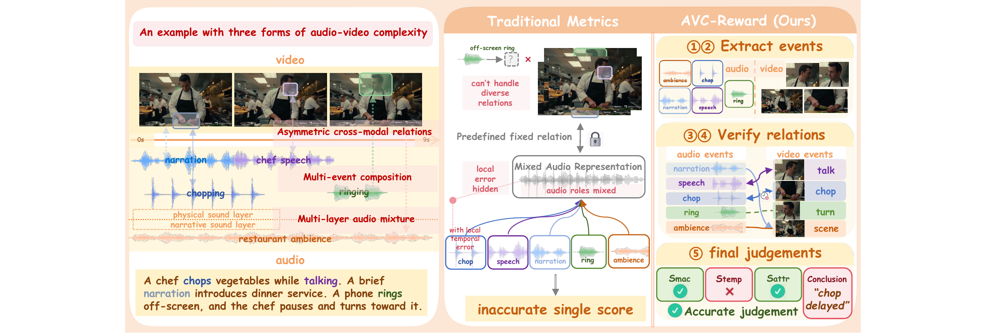

<div align="center">

# AVC-Reward: Event-Centric Audio-Video Consistency Evaluation

[**English**](README.md) | [**简体中文**](README_zh.md)

<p align="center">
  <a href="https://huggingface.co/Tsuki0512/AVC-Reward"></a>
  <a href="https://tsuki0512.github.io/AVC-Reward.github.io/"></a>
  <a href="https://tsuki0512.github.io/AVC-Reward.github.io/"></a>
</p>

</div>

## 📰 News

- **Released** — AVC-Reward model weights and reward-model inference code.
- **Released** — AVC-Reward LTX-2 LoRA weights, merge script, and joint audio-video inference code.
- **Released** — AVC-Benchmark data and scoring code.
- **Released** — Five-stage data annotation code.
- **Coming soon** — Paper preprint on arXiv. The badge currently points to the [Project Page](https://tsuki0512.github.io/AVC-Reward.github.io/).

### 👉 TODO

- [ ] Release reward-model and generation-model training code.
- [ ] Release training data after data-rights and privacy review.

---

## 🏗️ Brief Introduction

### Why event-centric evaluation?

Modern joint audio-video generation introduces multi-event composition, multi-layer audio mixtures, and asymmetric cross-modal relations, challenging existing clip-level and predefined-relation metrics. We propose an event-centric framework that disentangles individual events, distinguishes audio source roles, and cross-validates event-dependent relations across modalities, yielding a coarse-to-fine, three-level consistency metric.

<p align="center">
  
</p>

- **Global Narrative Harmony** (`S_mac`): Measures agreement in narrative content, entity identity, environment, and affective tone across the entire clip.
- **Event-level Temporal Synchronization** (`S_temp`): Evaluates event presence and temporal alignment of onset, offset, and duration under event-dependent cross-modal relations.
- **Fine-grained Attribute Alignment** (`S_attr`): Assesses physical, morphological, and causal-response compatibility within temporally verified event relations.

`S_AVC = (S_mac + S_temp + S_attr) / 3`

---

## 📦 Downloads

| Resource | Description | Download |
| :--- | :--- | :--- |
| **Reward Model** | AVC-Reward Qwen3-Omni reward-model checkpoint | [🤗 AVC-Reward](https://huggingface.co/Tsuki0512/AVC-Reward) |
| **Generation LoRA** | AVC-Reward LoRA for LTX-2 | [🤗 LTX-2-AVCReward-LoRA](https://huggingface.co/Tsuki0512/LTX-2-AVCReward-LoRA) |
| **AVC-Benchmark** | Audio-video benchmark media dataset | [🤗 AVC-Benchmark](https://huggingface.co/datasets/Tsuki0512/AVC-Benchmark) |

Model weights and benchmark media are hosted separately and are not stored in this repository.

---

## ⚡ Reward Model Inference

### Environment and checkpoint

Create the environment from the repository root. It includes the Qwen3-Omni/vLLM runtime and `ffmpeg` used for extracting audio from video when no audio sidecar is given. These commands assume Conda is installed and `conda` is available on `PATH`; otherwise add your existing Conda installation's `bin` directory to `PATH` first.


```bash
export WORK_ROOT="${WORK_ROOT:-$HOME/avc_reward_runtime}"
mkdir -p "$WORK_ROOT"/{envs,checkpoints,media/tmp,outputs,logs,cache,ltx-runtime}
source "$(conda info --base)/etc/profile.d/conda.sh"
conda env create --prefix "$WORK_ROOT/envs/avc-reward" --file reward_model/environment.inference.yml
conda activate "$WORK_ROOT/envs/avc-reward"
hf download Tsuki0512/AVC-Reward --local-dir "$WORK_ROOT/checkpoints/AVC-Reward"
```

### Start vLLM

The server reads local media files. Set `ALLOWED_LOCAL_MEDIA_PATH` to the directory containing the manifest media; the default host is `127.0.0.1`.

```bash
export WORK_ROOT="${WORK_ROOT:-$HOME/avc_reward_runtime}"
source "$(conda info --base)/etc/profile.d/conda.sh"
conda activate "$WORK_ROOT/envs/avc-reward"
export CUDA_VISIBLE_DEVICES=0
export MODEL_DIR="$WORK_ROOT/checkpoints/AVC-Reward"
export HOST=127.0.0.1
export PORT=8901
export TENSOR_PARALLEL_SIZE=1
export GPU_MEMORY_UTILIZATION=0.85
export MAX_MODEL_LEN=32768
export ALLOWED_LOCAL_MEDIA_PATH="$WORK_ROOT/media"
export TMPDIR="$WORK_ROOT/media/tmp"
export LOG_PATH="$WORK_ROOT/logs/reward_vllm.log"
bash reward_model/code/start_reward_vllm.sh
```

The startup script also accepts `SERVED_MODEL_NAME`, `GPU_MEMORY_UTILIZATION`, `MAX_MODEL_LEN`, `VLLM_BIN`, and `LOG_PATH` through environment variables. The served model name defaults to `reward_model`.

For single-GPU serving:

```bash
export CUDA_VISIBLE_DEVICES=0
export TENSOR_PARALLEL_SIZE=1
export MAX_MODEL_LEN=32768
bash reward_model/code/start_reward_vllm.sh
```

### Score a manifest

The client accepts CSV or JSONL. A JSONL row uses the existing `videos`/`audios` manifest keys; an optional sidecar audio overrides audio extracted from the video.

```jsonl
{"id":"clip-001","videos":["/absolute/path/to/media/clip-001.mp4"]}
{"id":"clip-002","videos":["/absolute/path/to/media/clip-002.mp4"],"audios":["/absolute/path/to/media/clip-002.wav"]}
```

```bash
export WORK_ROOT="${WORK_ROOT:-$HOME/avc_reward_runtime}"
source "$(conda info --base)/etc/profile.d/conda.sh"
conda activate "$WORK_ROOT/envs/avc-reward"
export TMPDIR="$WORK_ROOT/media/tmp"
mkdir -p "$WORK_ROOT/media/tmp" "$WORK_ROOT/outputs/reward"
ffmpeg -hide_banner -loglevel error -y \
  -f lavfi -i 'testsrc2=size=640x360:rate=10:duration=3' \
  -f lavfi -i 'sine=frequency=440:sample_rate=48000:duration=3' \
  -c:v mpeg4 -q:v 5 -pix_fmt yuv420p -c:a aac -shortest \
  "$WORK_ROOT/media/sample_with_audio.mp4"
python -c 'import json,os; p=os.path.join(os.environ["WORK_ROOT"],"media/sample_with_audio.mp4"); open(os.path.join(os.environ["WORK_ROOT"],"media/smoke.jsonl"),"w").write(json.dumps({"id":"avc-smoke-001","videos":[p]})+"\n")'
python reward_model/code/reward_model_inference.py \
  --input "$WORK_ROOT/media/smoke.jsonl" \
  --output-jsonl "$WORK_ROOT/outputs/reward/scores.jsonl" \
  --base-dir "$WORK_ROOT/media" \
  --endpoint http://127.0.0.1:8901/v1/chat/completions \
  --model reward_model
```

CSV defaults to the `video_path` column; add `--audio-column audio_path` when the CSV has sidecar audio. Other CLI options are `--video-column`, `--limit`, `--base-dir`, `--endpoint`, and `--model`.

The client sends separate `video_url` and `audio_url` blocks with the original five-layer system prompt. This follows the [Qwen3-Omni vLLM serving guidance](https://github.com/QwenLM/Qwen3-Omni/blob/main/README.md#vllm-serve-usage), which requires separate video/audio inputs in that API path. Successful rows contain the three scores—`macro_semantic_alignment`, `temporal_synchronicity`, and `fine_grained_event_correspondence`—plus their arithmetic mean as `rm_reward_avg`. The raw response and request metadata are preserved. A failed row has `ok: false` and an error string; it is not assigned a fallback score.

---

## 🎬 Generation Model Inference

### Environment and LTX-2 runtime

Create the separate generation environment from the repository root, then fetch the pinned LTX-2 source. The inference entry point uses the upstream `TI2VidOneStagePipeline` and passes independently configured video and audio guiders.

```bash
export WORK_ROOT="${WORK_ROOT:-$HOME/avc_reward_runtime}"
export CUDA_VISIBLE_DEVICES=0
export PIP_CONFIG_FILE=/dev/null
export PIP_INDEX_URL=https://pypi.org/simple
unset PIP_EXTRA_INDEX_URL || true
export PIP_CACHE_DIR="$WORK_ROOT/cache/pip"
export TMPDIR="$WORK_ROOT/media/tmp"
mkdir -p "$WORK_ROOT"/{envs,checkpoints,media/tmp,outputs,logs,cache,ltx-runtime}
source "$(conda info --base)/etc/profile.d/conda.sh"
conda env create --prefix "$WORK_ROOT/envs/avc-generation" --file generation_model/environment.inference.yml
conda activate "$WORK_ROOT/envs/avc-generation"
python -m pip install --index-url https://download.pytorch.org/whl/cu128 \
  torch==2.8.0 torchaudio==2.8.0 torchvision==0.23.0
python -m pip install -r generation_model/requirements.inference.txt
export LTX_V2_ROOT="$WORK_ROOT/ltx-runtime/LTX-2"
bash generation_model/code/install_ltx_runtime.sh
git -C "$LTX_V2_ROOT" rev-parse HEAD
```

The pinned runtime commit is [`d887bbd1e045b316d0a855f8d421209ecfc97ed1`](https://github.com/Lightricks/LTX-2/tree/d887bbd1e045b316d0a855f8d421209ecfc97ed1). Review the upstream [LTX-2 Community License](https://github.com/Lightricks/LTX-2/blob/d887bbd1e045b316d0a855f8d421209ecfc97ed1/LICENSE) before using the runtime or model.

### Download the base, Gemma, and AVC-Reward LoRA

The AVC-Reward adapter is intended for the LTX-2 dev base. Use `ltx-2-19b-dev.safetensors` with the matching Gemma 3 text encoder. Gemma access may require accepting its Hugging Face terms.

```bash
export WORK_ROOT="${WORK_ROOT:-$HOME/avc_reward_runtime}"
mkdir -p "$WORK_ROOT"/{checkpoints,cache/huggingface}
source "$(conda info --base)/etc/profile.d/conda.sh"
conda activate "$WORK_ROOT/envs/avc-generation"
export HF_HOME="$WORK_ROOT/cache/huggingface"
export HF_HUB_CACHE="$HF_HOME/hub"
hf auth login
hf download Lightricks/LTX-2 ltx-2-19b-dev.safetensors --local-dir "$WORK_ROOT/checkpoints/LTX-2"
hf download google/gemma-3-12b-it --local-dir "$WORK_ROOT/checkpoints/gemma-3-12b-it"
hf download Tsuki0512/LTX-2-AVCReward-LoRA --local-dir "$WORK_ROOT/checkpoints/LTX-2-AVCReward-LoRA"
```

### Merge and generate

```bash
python generation_model/code/merge_lora.py \
  --checkpoint-path "$WORK_ROOT/checkpoints/LTX-2/ltx-2-19b-dev.safetensors" \
  --lora-dir "$WORK_ROOT/checkpoints/LTX-2-AVCReward-LoRA" \
  --output-path "$WORK_ROOT/checkpoints/ltx2_avc_reward_merged.safetensors" \
  --dtype bf16 \
  --strict

CUDA_VISIBLE_DEVICES=0 python generation_model/code/inference.py \
  --model_path "$WORK_ROOT/checkpoints/ltx2_avc_reward_merged.safetensors" \
  --gemma_path "$WORK_ROOT/checkpoints/gemma-3-12b-it" \
  --prompt "A chef chops vegetables while a phone rings off-screen." \
  --num_frames 121 \
  --video_guidance_scale 3 \
  --audio_guidance_scale 7 \
  --stg_scale 1 \
  --seed 42 \
  --dtype bf16 \
  --output_dir "$WORK_ROOT/outputs/generation"
```

Inference writes an audio-video MP4 and a separate WAV. Core options include `--model_path`, `--gemma_path`, `--prompt`, `--negative_prompt`, `--num_frames`, `--height`, `--width`, `--frame_rate`, `--num_inference_steps`, `--seed`, `--output_dir`, and `--dtype`. Guider options are:

| Option | Meaning |
|---|---|
| `--video_guidance_scale` / `--audio_guidance_scale` | Set video / audio CFG scale |
| `--stg_scale` | Set both modality STG scales |
| `--video_stg_scale` / `--audio_stg_scale` | Set video / audio STG scale independently |
| `--video_rescale_scale` / `--audio_rescale_scale` | Set video / audio CFG rescale |
| `--a2v_guidance_scale` | Audio-to-video modality scale in the video guider |
| `--v2a_guidance_scale` | Video-to-audio modality scale in the audio guider |
| `--video_skip_step` / `--audio_skip_step` | Set video / audio guider skip step |
| `--video_stg_blocks` / `--audio_stg_blocks` | Set one or more integer STG block indices for video / audio |

A modality-specific STG scale overrides `--stg_scale`; if it is omitted, the shared value applies; if both are omitted, that modality's checkpoint-version preset applies. Unspecified CFG, rescale, modality, skip-step, and STG-block values retain their per-modality preset values. `detect_params()` selects presets for the recognized checkpoint version and falls back to the LTX-2 defaults when the version is unknown. The current pipeline supports `--dtype bf16` only. The merge tool accepts `--checkpoint-path`, `--lora-dir`, `--output-path`, `--dtype`, and `--strict`.

The base, Gemma encoder, LoRA, and merged model are downloaded separately from their linked sources.

---

## 📊 Benchmark Evaluation

The Hugging Face dataset holds audio-video media. The local CSV in this repository is a separate 706-row score table used by the existing evaluator; the evaluator does not download media or run model inference.

```bash
export WORK_ROOT="${WORK_ROOT:-$HOME/avc_reward_runtime}"
source "$(conda info --base)/etc/profile.d/conda.sh"
mkdir -p "$WORK_ROOT"/{envs,outputs/benchmark}
conda create -y --prefix "$WORK_ROOT/envs/avc-benchmark" python=3.11 pip
conda activate "$WORK_ROOT/envs/avc-benchmark"
python -m pip install -r benchmark/requirements.txt
python -m pip check
python benchmark/scripts/benchmark_eval.py \
  --csv benchmark/data/benchmark_all_data_all_models.csv \
  --output_dir "$WORK_ROOT/outputs/benchmark" \
  --deltas 0 0.05 0.1 0.15 0.2 0.25 0.3 0.5
```

The CSV contains `human_macro`, `human_temporal`, and `human_fine_grained` targets, scalar baseline columns, and grouped model columns using `MODEL__macro`, `MODEL__temporal`, and `MODEL__fine_grained`. The evaluator writes `benchmark_metrics.csv` and `benchmark_metrics_summary.json`, including five-parameter-logistic PLCC, SRCC, Pairwise, and Delta-Pairwise results. Example metrics are included under `benchmark/metrics/`.

---

The five-stage annotation pipeline and prompts are documented in [`data_annotation/pipeline/README.md`](data_annotation/pipeline/README.md).

---

## 🤝 Acknowledgements

[OmniNFT](https://github.com/zghhui/OmniNFT) · [LTX-2](https://github.com/Lightricks/LTX-2) · [JavisDiT](https://github.com/JavisVerse/JavisDiT) · [Qwen3-Omni](https://github.com/QwenLM/Qwen3-Omni)

## 🖊️ Citation

**TBD.** The arXiv identifier and BibTeX entry will be added after the preprint is available. Until then, see the [Project Page](https://tsuki0512.github.io/AVC-Reward.github.io/).

## ⚖️ License

Research use only. Model weights, benchmark media, and upstream code are governed by their respective terms. See the [LTX-2 Community License](https://github.com/Lightricks/LTX-2/blob/d887bbd1e045b316d0a855f8d421209ecfc97ed1/LICENSE) for the generation runtime.
